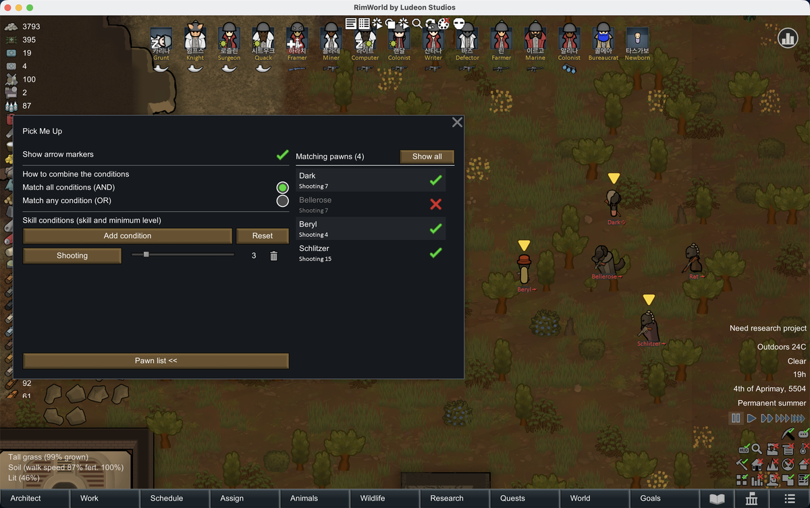
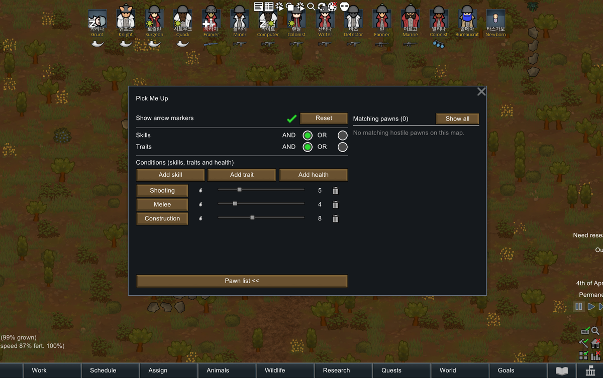

# Pick Me Up

Are you clicking on every enemy and opening their character tab just to find a pawn with the skills you want?

A RimWorld 1.7 mod that marks hostile pawns who have the skills you are looking for with an arrow above their heads, so you can spot the right recruit at a glance.

## Demo



The condition window, opened with your own shortcut key:



The pawn list next to it. Untick a pawn to hide its arrow (you can also click an arrow on the map), and tick it again to bring it back:


## Features

- Pick any skills (modded skills included) and a minimum level for each one.
- Pick a passion (none, minor or major) for any skill, shown as flame icons.
- Pick traits (for example Tough or Kind) that a pawn must have. Traits are yes or no, so they have no level.
- Combine the conditions with **AND** ("Medicine and Intellectual at level 8 or higher") or **OR** ("Medicine or Intellectual at level 8 or higher").
- If a matching hostile pawn is on the map you are viewing, an arrow appears above their head.
- A condition window you can open while playing, with a pawn list next to it that shows every matching pawn. Untick a pawn to hide its arrow, or just click the arrow on the map. You can show it again from the list.
- A switch to hide all arrows without losing your conditions.
- No keyboard shortcut is assigned by default. You choose your own keys.
- Pawns who can never do a skill (for example, incapable of violence) do not match that skill. Prisoners and slaves of your colony are never marked.
- Languages: English, Korean.

## Tech Stack

- C# on .NET 10 (RimWorld 1.7 runs on .NET 10)
- RimWorld 1.7 game assemblies (`Assembly-CSharp`, `UnityStubs`), referenced only
- No Harmony or other mod dependencies
- Written with [Claude Code](https://claude.com/claude-code)

## Getting Started

### Steam Workshop

Subscribe on the [Steam Workshop page](https://steamcommunity.com/sharedfiles/filedetails/?id=3845908753), then enable **Pick Me Up** in the mod list and restart the game.

### Build from source

Prerequisites: RimWorld 1.7 and the [.NET 10 SDK](https://dotnet.microsoft.com/download). The project file looks for the game in the default macOS Steam location. On other setups, pass the path with `-p:RimWorldDir=...`.

```bash
# 1. Clone into the game's Mods folder (or clone anywhere and symlink it there)
cd "$HOME/Library/Application Support/Steam/steamapps/common/RimWorld/Mods"
git clone https://github.com/<your-account>/rimworld-pick-me-up.git PickMeUp

# 2. Build. The DLL is written to Assemblies/
cd PickMeUp/Source/PickMeUp
dotnet build -c Release

# Different game location:
# dotnet build -c Release -p:RimWorldDir="/path/to/RimWorld"
```

Then start the game, enable **Pick Me Up** in the mod list and restart. The log should show `[Pick Me Up] Loaded.`.

The built `Assemblies/*.dll` and `*.pdb` files are not committed, so every fresh clone has to be built once.

## Usage

1. Open `Options > Keyboard config`, find **Pick Me Up** and assign a key to **Open/close condition window** (and optionally **Show/hide arrow markers**).
2. Press that key during play, click **Add skill** or **Add trait**, and choose one from the list. For a skill, drag the slider to the minimum level and click the flame icon to set a passion if you want one. Repeat for more.
3. Choose **Match all conditions (AND)** or **Match any condition (OR)**.
4. Matching hostile pawns get an arrow right away. The same editor is also available under `Options > Mod settings > Pick Me Up`.
5. If you only like some of them, use the pawn list next to the window: untick a pawn to hide its arrow, or click the arrow on the map. **Show all** brings every hidden arrow back.

For example, with `Shooting 10` and `Melee 10` set to OR, any raider who is level 10 or higher in either skill is marked. Switch to AND and only raiders who reach both are marked.

To check the matching without looking at the map, enable Development mode and run `Debug actions > Pick Me Up > Log matching hostile pawns`.

## Project Structure

```
About/About.xml                 Mod metadata (name, packageId, supported version)
Defs/KeyBindings.xml            Keyboard shortcut definitions
Languages/                      English (default) and Korean text
Textures/PickMeUp/Arrow.png     The arrow marker
Source/PickMeUp/
  PickMeUp.csproj               Builds into ../../Assemblies/
  PickMeUpMod.cs                Mod entry point and mod settings page
  PickMeUpSettings.cs           Saved settings (conditions, AND/OR, on/off)
  SkillCondition.cs             One "skill + minimum level" rule
  PawnMatcher.cs                Decides which hostile pawns match
  ArrowMarkerMapComponent.cs    Draws the arrows on the map
  ConditionEditor.cs            Condition UI shared by settings and window
  Window_Conditions.cs          The in-game condition window
  PickMeUpGameComponent.cs      Keyboard shortcut handling
  PickMeUpDebug.cs              Development-mode logging action
```

## License

This project is licensed under the [MIT License](LICENSE).

---

# 픽 미 업

## 소개

원하는 스킬을 가진 림을 영입하려고 적군을 하나하나 클릭해서 캐릭터 창을 확인하고 계신가요?

RimWorld 1.7용 모드입니다. 원하는 스킬을 가진 적대 림의 머리 위에 화살표를 표시해서, 영입할 림을 쉽게 찾을 수 있게 해 줍니다.

## 데모

스크린샷은 위 Demo 섹션을 참고하세요. 첫 번째는 조건에 맞는 적대 림 위에 뜬 화살표 마크, 두 번째는 조건 창, 세 번째는 림 목록입니다. 림 목록에서 체크를 풀면 그 림의 화살표가 숨겨지고(맵의 화살표를 클릭해도 됩니다), 다시 체크하면 돌아옵니다.

## 주요 기능

- 원하는 스킬(모드 스킬 포함)과 스킬별 최소 레벨을 지정합니다.
- 조건을 **AND**("의학과 연구가 모두 8레벨 이상") 또는 **OR**("의학 또는 연구가 8레벨 이상")로 묶을 수 있습니다.
- 지금 보고 있는 맵에 조건에 맞는 적대 림이 있다면 머리 위에 화살표가 표시됩니다.
- 플레이 중에 열 수 있는 조건 창과, 그 옆에서 조건에 맞는 림을 한눈에 보여 주는 림 목록이 있습니다. 체크를 풀어 그 림의 화살표를 숨길 수 있고, 맵의 화살표를 클릭해도 숨겨집니다. 목록에서 다시 표시할 수 있습니다.
- 조건은 유지한 채 모든 화살표만 끄는 스위치가 있습니다.
- 기본 단축키는 지정되어 있지 않으며, 직접 키를 정합니다.
- 해당 스킬을 아예 못 하는 림(예: 폭력 불가)은 그 스킬 조건에 맞지 않는 것으로 처리합니다. 정착지의 죄수와 노예는 표시하지 않습니다.
- 지원 언어: 영어, 한국어

## 기술 스택

- .NET 10 기반 C# (RimWorld 1.7은 .NET 10으로 실행됩니다)
- RimWorld 1.7 게임 어셈블리(`Assembly-CSharp`, `UnityStubs`) 참조 전용
- Harmony 등 다른 모드 의존성 없음
- [Claude Code](https://claude.com/claude-code)로 작성했습니다

## 시작하기

### Steam Workshop

[Steam Workshop 페이지](https://steamcommunity.com/sharedfiles/filedetails/?id=3845908753)에서 구독한 뒤, 게임의 모드 목록에서 **Pick Me Up**을 켜고 게임을 재시작하면 됩니다.

### 소스에서 빌드

필요한 것은 RimWorld 1.7과 .NET 10 SDK입니다. 프로젝트 파일은 macOS 기본 Steam 경로에서 게임을 찾습니다. 다른 환경에서는 `-p:RimWorldDir=...`로 경로를 지정하세요. 명령어는 위 Build from source와 동일합니다.

빌드한 뒤 게임에서 모드 목록의 **Pick Me Up**을 켜고 재시작하면 됩니다. `Assemblies/`의 `.dll`과 `.pdb`는 커밋하지 않으므로, 저장소를 새로 받으면 한 번 빌드해야 합니다.

## 사용 예시

1. `환경설정 → 키보드 조작`에서 **Pick Me Up** 항목을 찾아 **조건 창 열기/닫기**에 키를 지정합니다. 화살표 마크 켜기/끄기 키도 원하면 지정합니다.
2. 플레이 중 그 키로 조건 창을 열고, **조건 추가**를 눌러 스킬을 고른 뒤 슬라이더로 최소 레벨을 정합니다. 스킬을 더 넣을 수도 있습니다.
3. **모든 조건 만족 (AND)** 또는 **하나라도 만족 (OR)** 중에서 고릅니다.
4. 조건에 맞는 적대 림에 바로 화살표가 표시됩니다. 같은 설정 화면이 `환경설정 → 모드 설정 → Pick Me Up`에도 있습니다.
5. 마음에 드는 림만 남기고 싶다면 창 옆의 림 목록을 쓰세요. 체크를 풀면 그 림의 화살표가 숨겨지고, 맵의 화살표를 클릭해도 됩니다. **모두 표시**를 누르면 숨긴 화살표가 전부 돌아옵니다.

예를 들어 `사격 10`과 `격투 10`을 OR로 두면 둘 중 하나라도 10레벨 이상인 습격자가 표시됩니다. AND로 바꾸면 둘 다 10레벨 이상인 습격자만 표시됩니다.

## 프로젝트 구조

파일 구성은 위 Project Structure와 동일합니다.

## 라이선스

이 프로젝트는 [MIT 라이선스](LICENSE)를 따릅니다.
